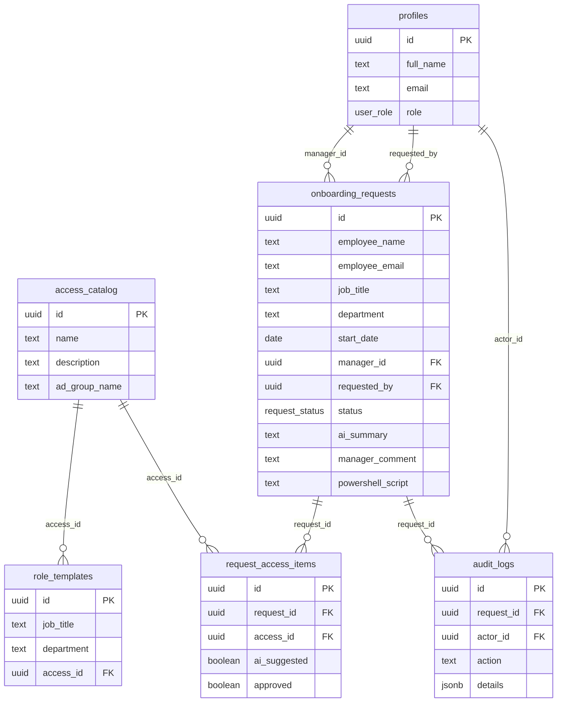

# AccessFlow AI data model

The application uses the Supabase Cloud schema below. A manual fresh-project setup script is available at [supabase/setup.sql](../supabase/setup.sql); the application does not run migrations or change the database schema.

## Tables and relationships

- **`profiles`** — a user profile keyed to the Supabase Auth user UUID. `role` is `hr`, `manager`, or `it_admin`.
- **`access_catalog`** — reusable access permissions and their optional Active Directory group mapping (`ad_group_name`).
- **`role_templates`** — maps a job title and department to one catalog entry. Multiple rows can represent multiple recommendations for a role.
- **`onboarding_requests`** — the employee onboarding record, manager, HR requester, status, rationale, manager comment, and optional saved PowerShell script.
- **`request_access_items`** — joins onboarding requests to catalog items and records whether an item was suggested and approved. A null `approved` value means it has not yet been reviewed.
- **`audit_logs`** — append-only application history with an optional request and actor reference plus JSON details. Actions include request creation/review, access denials, script generation, provisioning, and catalog/template changes.

## RLS access expectations

RLS is enabled in the hosted database and is the authoritative access-control boundary. The app uses the signed-in user's Supabase session and anon key only. Policies should permit:

- Users to read their own profile; authenticated HR users to read manager profiles for assignment. Profile role changes remain administrator-controlled.
- Authenticated users to read the access catalog and role templates; only IT administrators to change them.
- HR users to create and read their own requests; assigned managers to read/review their requests; IT administrators to read all requests.
- Request access-item reads and updates only when the parent request is visible to the caller under the preceding rules.
- Authenticated actors to insert audit events for actions they are authorized to perform; IT administrators to read audit events.

The browser and server UI surface RLS errors as errors. Empty data is not used as a fallback for denied reads.
